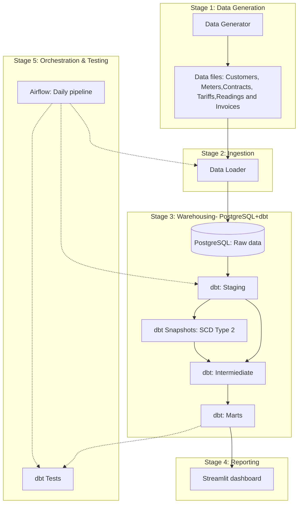

# Utility billing data warehouse

## Project Overview

An end-to-end batch data engineering project for a fictional German municipal energy supplier (Stadtwerk). The platform is designed to integrate meter readings, customer, contract, tariff and invoice data into a PostgreSQL data warehouse, with automated transformations, billing validation and operational reporting.

## Business Problem

Energy suppliers process large volumes of metering and billing data from multiple sources. Different data file formats, inconsistent meter readings, duplicate records, incorrect tariffs and invalid contracts can lead to billing discrepancies, inaccurate reporting and time-consuming manual investigations.

## Proposed Solution

The platform focuses on reliable data integration, automated billing validation and data quality monitoring through the following capabilities:

- Data Integration: Consolidation of customer, meter reading, contract, tariff and invoice datasets into a centralized data warehouse.

- Data Transformation: Cleaning, validation and transformation of raw data into structured, analytics-ready datasets.

- Billing Reconciliation: Detection of consumption mismatches, missing or duplicate meter readings, incorrect tariffs and inactive contracts.

- Historical Data Management: Preservation of tariff history using SCD Type 2 for accurate historical billing analysis.

- Pipeline Automation: Scheduling and orchestration of data processing workflows using Apache Airflow.

- Operational Monitoring: Streamlit-based dashboards for tracking billing discrepancies, data quality and operational KPIs.

**Expected Impact**: The solution emphasizes <i>data reliability, traceability, historical accuracy </i>and <i>efficient identification </i> of billing discrepancies.

## Technical Stack
Python, SQL, PostgreSQL, dbt, Airflow, Docker Compose, GitHub Actions, pytest, Streamlit.

## Architecture Diagram



## Billing Rules
The set of business rules used in this project could be viewed <a href="docs/docs/billing_rules.md">here.</a>

## Data Model
A sketch of the data model could be viewed <a href="docs/docs/data_model.md">here.</a>

## Getting Started

### Prerequisites

- Docker Desktop with Docker Compose
- Git
- Make

### Setup

Clone the repository and navigate to the project directory.

```bash
git clone <repository-url>
cd utility-billing-dwh
```

Create a local environment file using the provided configuration template.

```bash
cp .env.example .env
```

### Run the Platform

Start the required services:

```bash
make up
```

Execute the data pipeline:

```bash
make run
```

### Testing and Code Quality

Run automated tests:

```bash
make test
```

Run linting and code quality checks:

```bash
make lint
```